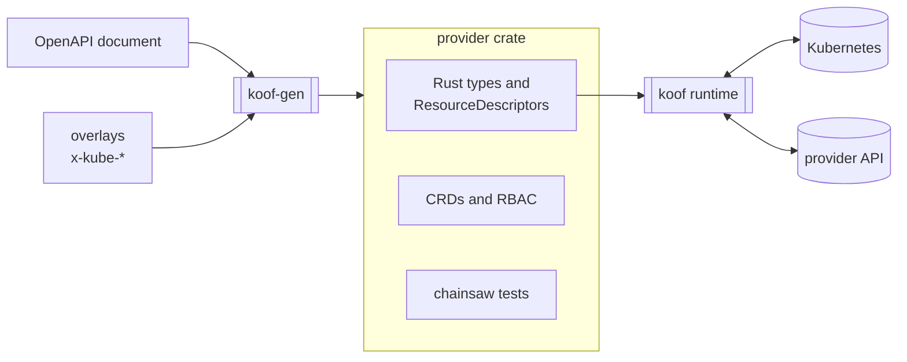
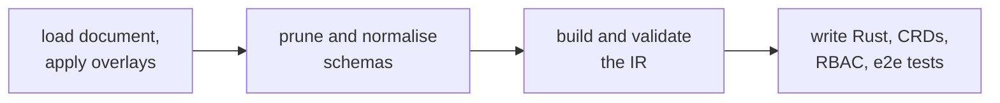
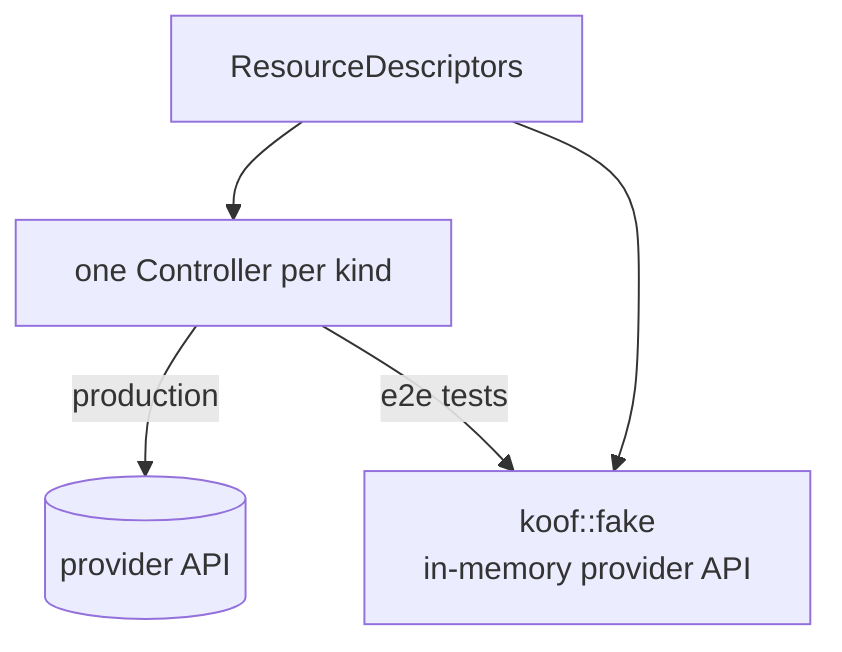

# Architecture

koof splits an operator into what differs between APIs and what does not.

## Generator

`koof-gen` reads the provider's OpenAPI document and applies the
[overlays](https://spec.openapis.org/overlay/latest.html) listed in
`openapi/sources`. The overlays add the `x-kube-*` extensions, which hold everything
the OpenAPI document does not say: which schemas are resources, which operation is
which lifecycle step, where identifiers come from, how resources reference each
other.

The generator then:

1. prunes the document to the schemas that resources actually use and normalises
   them for Kubernetes (structural schemas, `nullable`, int-or-string);
2. builds an intermediate representation and validates it: references
   point to known resources, path parameters and credentials can be resolved,
   and test fixtures have no reference cycles;
3. writes Rust (API types via [typify](https://github.com/oxidecomputer/typify),
   custom resources via [kube-rs](https://kube.rs)), CRDs, RBAC and
   [chainsaw](https://kyverno.github.io/chainsaw) tests.

The generated code is plain data. Each resource is a static `ResourceDescriptor`:
its operations, path parameters, references, credentials and fields. There is no
per-resource logic.

## Runtime

`koof` turns descriptors into controllers. One generic
[`Controller`](https://docs.rs/kube/latest/kube/runtime/struct.Controller.html) runs
per kind, and the same code handles every resource: resolving references,
building requests, comparing state, writing status. A bug fixed in the runtime is
fixed for every provider, and a new resource does not need new Rust.

The same descriptors drive `koof::fake`, an in-memory implementation of the
provider API. The generated e2e tests run against it, so a resource is tested
end to end without an account at the provider.

## Why overlays

The OpenAPI document is downloaded from the provider and kept as is. Everything
koof needs lives in overlays next to it, one file per resource. So:

- updating the API document is a file replacement, and the overlays show what broke;
- a resource is reviewed as one small YAML file;
- the operator's behaviour is reproducible from inputs in the repository, and
  `scripts/check-generated.sh` enforces that.

## Trade-offs

- An API that does not fit observe/create/update/delete on one resource, such as
  asynchronous jobs or batch endpoints, needs runtime support first.
- The desired state is the request body schema. Fields the API only returns are
  `atProvider` only, and write-only fields cannot be checked for drift.
- Identity is the external name. An API without a stable ID for a resource cannot
  be observed reliably.
