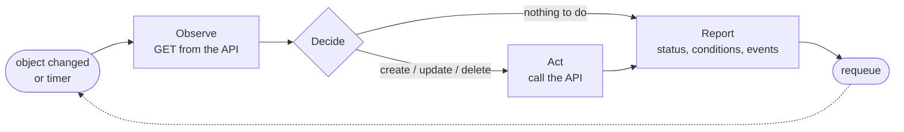
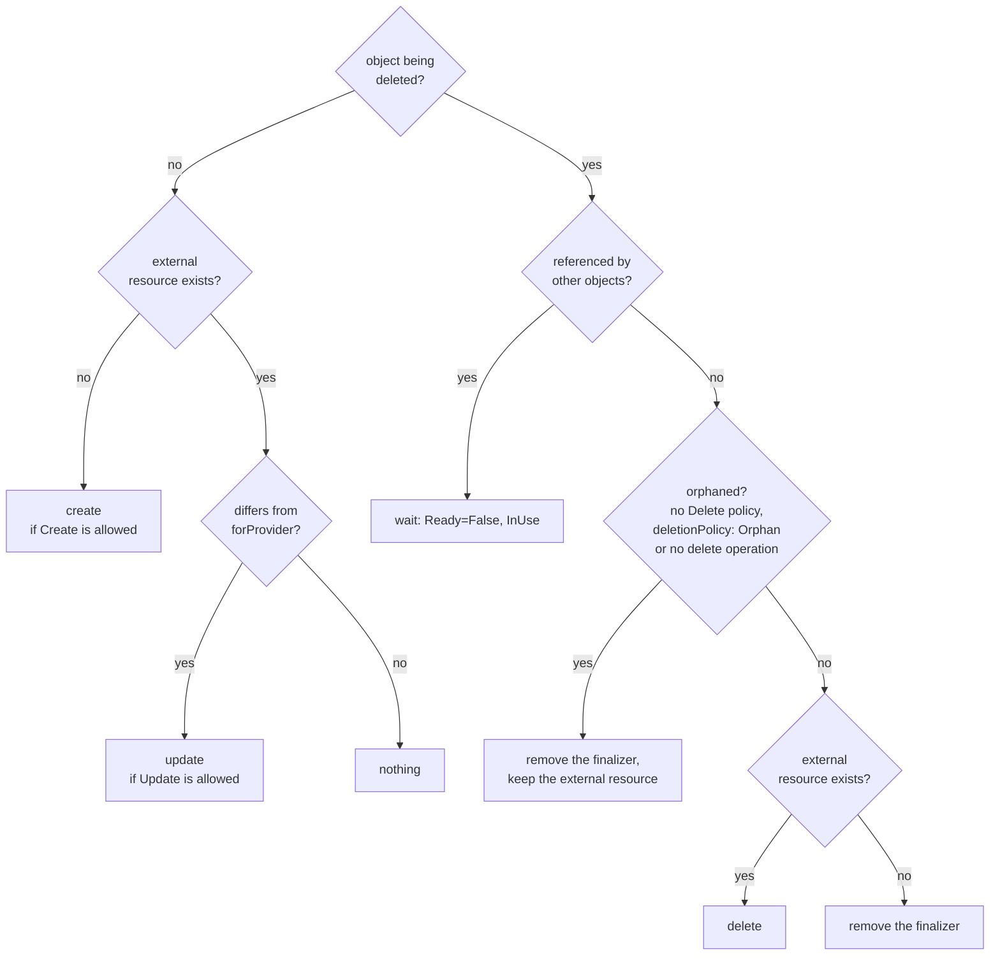
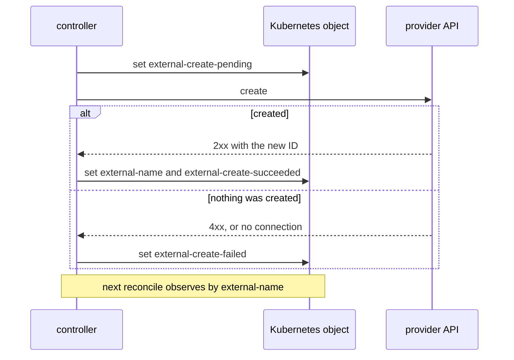
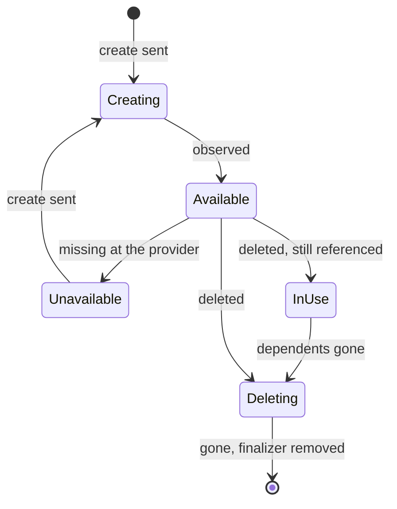

# How reconciliation works

A koof controller follows the [operator pattern](https://kubernetes.io/docs/concepts/extend-kubernetes/operator/):
it watches a custom resource and repeatedly makes the external world match it. The
model is [Crossplane's managed resource](https://docs.crossplane.io/latest/concepts/managed-resources/):
`spec.forProvider` is the desired state, `status.atProvider` is what the provider
API reports, and the conditions `Ready` and `Synced` summarise the result.

Every reconcile is the same short loop: observe, decide, act, report.

## Observe

koof calls the `observe` operation and the result is one of two states:

- **exists**: the API answered with the resource. It is copied into
  `status.atProvider`, after unwrapping `response.path`.
- **missing**: the API answered `404`, a path parameter is not known yet (no
  external name before the first create), or the `response.deletedWhen` field is
  set (soft-deleted).

Path parameters, credentials and request bodies are resolved first. A reference
to an object that is not `Ready` yet is not an error: the reconcile waits and tries
again.

## Decide

The decision depends on the observation and on `spec.managementPolicies` (default
`["*"]`, everything allowed) and `spec.deletionPolicy`:

`Observe` must always be allowed. `managementPolicies: [Observe]` turns an object
into a read-only import. Without `Delete`, or with `deletionPolicy: Orphan`,
deleting the object leaves the external resource in place.

## Act

### Create

Creating something twice is the worst failure of an operator, so a create is
bracketed by annotations on the object (all prefixed with the resource's API
group):

1. `external-create-pending` is set to the current time, guarded by
   `resourceVersion`.
2. The `create` request is sent.
3. On success, the new ID from `result.identifiers` goes to `external-name` and
   `external-create-succeeded` is set. On a failure that proves nothing was
   created (a `4xx`, or no connection at all), `external-create-failed` is set.

If the controller crashes between 1 and 3, the next reconcile finds `pending`
without an outcome. It refuses to create again and reports the error: either set
`external-name` to the resource that was created, or remove `pending` to retry.
Deleting the object does not skip this: with `deletionPolicy: Delete` the
finalizer stays until the outcome is known, or the policy is changed to `Orphan`.
For a minute after a successful create, a missing observation is treated as the
API catching up, not as a reason to create again.

### Update

koof compares `spec.forProvider` with `status.atProvider` field by field. Integers
are compared exactly and floats with a relative tolerance. Fields unset in the spec,
and fields the API does not return, are not compared. If anything differs, the `update` operation is
sent and the resource is observed again.

Some APIs normalise values: a record name gets lower-cased, a list comes back
sorted. Such drift survives the update. koof reports a `DriftPersists` warning and
does not repeat the same update until the object's `generation` changes.

### Late initialization

Fields that are unset in `spec.forProvider` but have a value in the observation are
copied into the spec (`LateInitialized` event). The spec then shows the full state
of the resource, and a later change to such a field is detected as drift.
`lateInitialize: false` on a field, or a `managementPolicies` list without
`LateInitialize`, turns this off.

### Delete

Every managed object carries a finalizer, so it stays in the cluster until the
external resource is dealt with:

- If other managed objects still reference it (a `Zone` with `DNSRecord`s), deletion
  waits. `Ready` is `False` with reason `InUse` and the message lists the
  dependents.
- A kind without a `delete` operation, or with an orphan policy, is released at
  once with an `Orphaned` event.
- Otherwise the `delete` operation is sent, then koof observes again until the
  resource is gone. The request is not repeated more often than once a minute.

## Report

The status always carries:

- `Ready`: `True` (`Available`) when the external resource exists, otherwise
  `False` with reason `Creating`, `Deleting`, `InUse` or `Unavailable`.
- `Synced`: `True` (`ReconcileSuccess`) when the last reconcile succeeded,
  otherwise `False` (`ReconcileError`) with the error chain as the message.

Events (`Created`, `Updated`, `Deleted`, `LateInitialized`, `ReconcileError`, …)
record each action.

## Timing

| Situation | Next reconcile |
|---|---|
| in sync | 5 min |
| missing and cannot be created | 30 s |
| waiting for a reference, a dependent or a delete | 15 s |
| after an action, to confirm it | 5 s |
| transient error (`429`, `5xx`, network) | exponential backoff from 5 s to 5 min, or `Retry-After` |
| permanent error (other `4xx`, invalid input) | 5 min |

Periodic delays get ±10 % jitter, so objects created together do not all hit the API
at the same moment. Any change to the object triggers a reconcile immediately.
