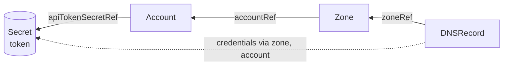
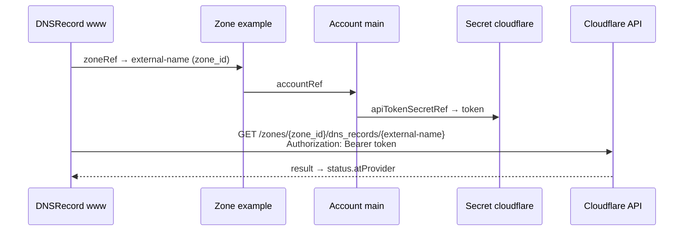

# Tutorial: add a resource to a provider

In this tutorial we add Cloudflare DNS records to the Cloudflare provider: a
`DNSRecord` kind that lives in a `Zone` and creates, updates and deletes records
through the Cloudflare API. By the end you will have a generated CRD, a working
controller and an end-to-end test.

`DNSRecord` already exists in the repository, so we rebuild it from scratch and
compare the result with the original at the end.

You need Rust, Docker, [kind](https://kind.sigs.k8s.io),
[kubectl](https://kubernetes.io/docs/reference/kubectl/) and
[chainsaw](https://kyverno.github.io/chainsaw).

## 1. Start from a clean slate

```sh
cd crates/providers/cloudflare/openapi
mv cloudflare.dns-record.overlay.yaml /tmp/dns-record.original.yaml
sed -i.bak '/cloudflare.dns-record.overlay.yaml/d' sources && rm sources.bak
cd -
scripts/regen.sh cloudflare
```

The DNSRecord CRD, its Rust module and its e2e test are gone. Everything a provider
knows about a resource comes from its overlay.

## 2. Find the API

A resource needs at least an endpoint that reads it. Search the OpenAPI document
for DNS record paths:

```sh
grep -n "^  /zones/{zone_id}/dns_records" crates/providers/cloudflare/openapi/cloudflare.yaml
```

The ones we need:

| Lifecycle | Operation |
|---|---|
| observe | `GET /zones/{zone_id}/dns_records/{dns_record_id}` |
| create | `POST /zones/{zone_id}/dns_records` |
| update | `PATCH /zones/{zone_id}/dns_records/{dns_record_id}` |
| delete | `DELETE /zones/{zone_id}/dns_records/{dns_record_id}` |

The `POST` request body is the schema `dns-records_dns-record-post`. Its properties
become the `spec.forProvider` of our kind.

## 3. Declare the resource

Create `crates/providers/cloudflare/openapi/cloudflare.dns-record.overlay.yaml`:

```yaml
overlay: 1.1.0
info:
  title: Cloudflare DNSRecord
  version: 0.0.1
extends: ./cloudflare.yaml
actions:
  - target: $.components.schemas['dns-records_dns-record-post']
    update:
      x-kube-resource:
        name: dns_record
        apiVersion: zones.cloudflare.kube.nas1k.dev/v1alpha1
        kind: DNSRecord

        identifiers:
          external_id:
            type: external_name

        references:
          zone:
            from: spec.forProvider.zoneRef
            target: zone

        credentials:
          securityScheme: api_token
          source:
            type: related
            via: [zone, account]

        fields:
          mode: explicit
          forProvider: [type, name, content, data, ttl, priority, proxied, comment, tags, settings]
          atProvider: [id, type, name, content, data, ttl, priority, proxied, proxiable,
                       comment, tags, settings, created_on, modified_on]
```

How the three resources fit together:



What each part does:

- `name` is the internal name other overlays use to refer to this resource.
  `apiVersion` and `kind` are what users write in their manifests.
- `identifiers.external_id` names the value that identifies the record in
  Cloudflare. `external_name` means it is stored in the
  `zones.cloudflare.kube.nas1k.dev/external-name` annotation, which koof sets after
  a create.
- `references.zone` adds a `zoneRef` field to `spec.forProvider`. It points at a
  `Zone` in the same namespace, and koof resolves it before calling the API.
- `credentials` say where the API token comes from. A record has no token of its
  own, so koof follows `zoneRef`, then the zone's `accountRef`, and uses the
  account's token.
- `fields` picks the properties of the schema that are exposed: `forProvider` is
  what users set, `atProvider` is what koof reports in the status.

## 4. Map the operations

Append the four lifecycle operations to `actions`:

```yaml
  - target: $.paths['/zones/{zone_id}/dns_records/{dns_record_id}'].get
    update:
      x-kube-operation:
        resource: dns_record
        lifecycle: observe
        response:
          path: result
        pathParameters:
          zone_id:
            type: related_identifier
            via: [zone]
            name: external_id
          dns_record_id:
            type: external_name

  - target: $.paths['/zones/{zone_id}/dns_records'].post
    update:
      x-kube-operation:
        resource: dns_record
        lifecycle: create
        pathParameters:
          zone_id:
            type: related_identifier
            via: [zone]
            name: external_id
        result:
          identifiers:
            external_id: response.body.result.id
```

- `pathParameters` tell koof how to fill each `{placeholder}`. `zone_id` is the
  `external_id` of the zone that `zoneRef` points at. `dns_record_id` is our own
  external name.
- `response.path: result` unwraps Cloudflare's `{"success": …, "result": {…}}`
  envelope, so `status.atProvider` holds the record itself.
- `result.identifiers` on create tells koof where the new ID is in the response.
  koof writes it to the external-name annotation.

For one observe, koof resolves everything like this:



Add `update` (`PATCH …/{dns_record_id}`) and `delete` (`DELETE …/{dns_record_id}`)
the same way: both take the same two `pathParameters` as observe. The request body
of create and update defaults to `spec.forProvider`.

## 5. Generate

Register the overlay in `crates/providers/cloudflare/openapi/sources`, where it was
before:

```text
cloudflare.zone.overlay.yaml
cloudflare.dns-record.overlay.yaml
```

```sh
scripts/regen.sh cloudflare
```

Look at what appeared:

- `src/generated/zones/v1alpha1/dns_record.rs`: the `DNSRecord` custom resource and
  its descriptor;
- `deploy/providers/cloudflare/crds.yaml`: the CRD
  `dnsrecords.zones.cloudflare.kube.nas1k.dev`;
- `deploy/providers/cloudflare/rbac.yaml`: permissions for the new kind.
- `crates/providers/cloudflare/README.md` and
  `crates/providers/cloudflare/docs/zones.cloudflare.kube.nas1k.dev_v1alpha1_dnsrecord.md`:
  the kind in the provider's table and its page with every field.

No Rust was written by hand: `controllers()` in `src/generated/mod.rs` already
registers the new controller.

## 6. Add validation and a test

Add a validation rule and an end-to-end fixture to `x-kube-resource`:

```yaml
        validations:
          - rule: "!has(self.ttl) || self.ttl == 1 || (self.ttl >= 30 && self.ttl <= 86400)"
            message: "ttl must be 1 (automatic) or between 30 and 86400 seconds"

        test:
          forProvider:
            type: A
            name: www.example.com
            content: 192.0.2.1
            ttl: 1
            proxied: false
          update:
            content: 192.0.2.2
            comment: updated by koof e2e
```

The rule becomes a CEL `x-kubernetes-validations` entry, so the API server rejects
a bad `ttl` before koof sees it. The fixture becomes
`e2e/generated/dns-record/chainsaw-test.yaml`: it creates an Account, a Zone and
the record, waits for `Ready`, applies the update, then deletes everything.

```sh
scripts/regen.sh cloudflare
scripts/e2e.sh cloudflare
```

`e2e.sh` runs the controller against `koof-cloudflare-fake`, an in-memory API
built from the same descriptors, so no Cloudflare account is needed.

## 7. Compare

```sh
diff <(grep -v '^ *#' /tmp/dns-record.original.yaml) \
     <(grep -v '^ *#' crates/providers/cloudflare/openapi/cloudflare.dns-record.overlay.yaml)
git status
```

Apart from formatting, your overlay should match the original and `git status` should
show only the overlay. If generated files differ, compare the overlays.

## 8. Try it against Cloudflare

Install the CRDs and run the controller against your current kubeconfig:

```sh
cargo run -p cloudflare-provider --bin koof-cloudflare-manifests | kubectl apply --server-side -f -
cargo run -p cloudflare-provider --bin koof-cloudflare
```

In another terminal, adopt an existing account and zone and create a record:

```yaml
apiVersion: v1
kind: Secret
metadata:
  name: cloudflare
stringData:
  token: <API token>
---
apiVersion: cloudflare.kube.nas1k.dev/v1alpha1
kind: Account
metadata:
  name: main
  annotations:
    cloudflare.kube.nas1k.dev/external-name: <account ID>
spec:
  managementPolicies: [Observe]
  forProvider:
    name: <account name>
    apiTokenSecretRef: {name: cloudflare, key: token}
---
apiVersion: cloudflare.kube.nas1k.dev/v1alpha1
kind: Zone
metadata:
  name: example
  annotations:
    cloudflare.kube.nas1k.dev/external-name: <zone ID>
spec:
  managementPolicies: [Observe]
  forProvider:
    name: example.com
    accountRef: {name: main}
---
apiVersion: zones.cloudflare.kube.nas1k.dev/v1alpha1
kind: DNSRecord
metadata:
  name: www
spec:
  forProvider:
    zoneRef: {name: example}
    type: A
    name: www.example.com
    content: 192.0.2.1
    ttl: 1
```

```sh
kubectl get dnsrecord www -o yaml
```

`managementPolicies: [Observe]` imports the account and zone without letting koof
change or delete them. The record is fully managed: it is created now, and is updated
when you edit `spec.forProvider`. It is deleted from Cloudflare when you delete the
object.

## Next

- [Overlay recipes](../how-to/overlay-recipes.md) for other API shapes.
- [Reconciliation](../explanation/reconciliation.md) for what the controller does
  with the operations you mapped.
- [Overlay reference](../reference/overlays.md) for every key.
